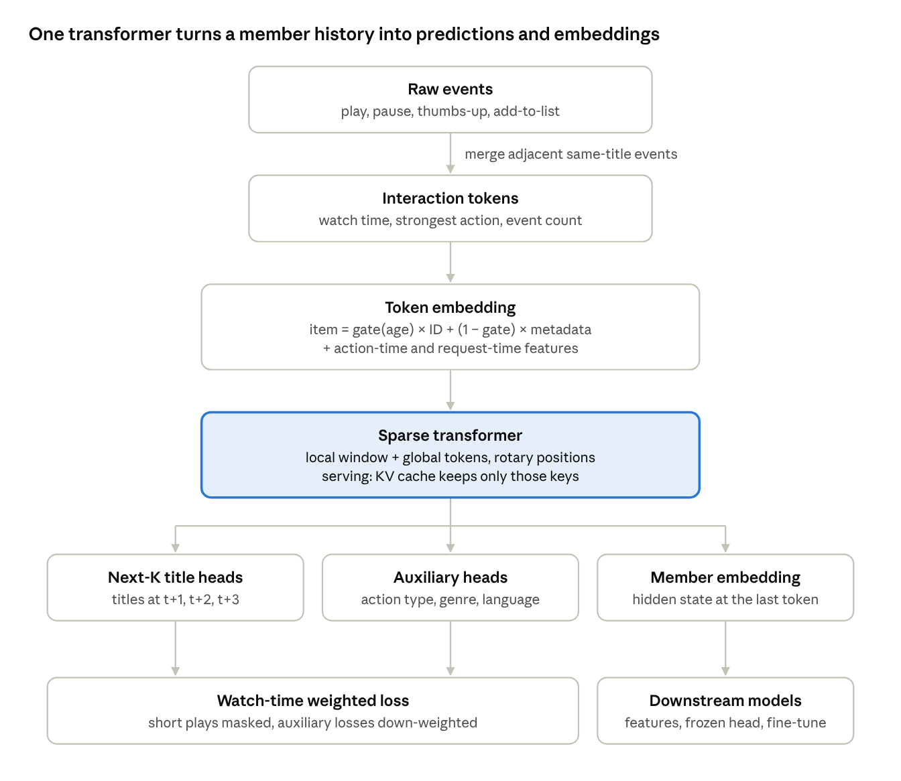

# Building a Foundation Model for Personalized Recommendation

*One model. Every member's full history. Many recommenders.*

Netflix's bet is simple: instead of maintaining dozens of specialised models, train one large transformer on members' complete interaction histories and let every downstream system build on it.

This post walks through how I built each piece, what the code does, and what is still left to do.

## At a glance.

- **2.5x shorter sequences** after interaction tokenization, with no loss of watch-time signal.
- **Sparse attention**: a local window plus a few global tokens, so cost grows roughly linearly with history length.
- **Next-K prediction**: the model predicts the next three titles, plus action type, genre and language.
- **Cold-start ready**: new titles lean on metadata until they have enough watches of their own.
- **Bounded serving memory**: the KV cache never holds more than window + global tokens, however long the history.
- **Stable embeddings** across retrains, so downstream consumers don't break.

## One model. Many recommenders.

Netflix's homepage is served by many specialised models: "Continue Watching", "Because you watched", search, notifications. Each one is trained separately, and each one re-learns the same thing: what this member likes.

Netflix's answer was to centralise that learning. A single foundation model reads a member's entire history and produces two things everyone can reuse: predictions of what comes next, and embeddings of members and titles.

The idea comes straight from LLMs. Treat each interaction as a token, train autoregressively on next-token prediction, and scale. Netflix reports that recommendation quality kept improving as they scaled the model, much like scaling laws in language modelling.

I wanted to understand every moving part of that recipe. So I built it.

## Interactions, tokenized.

Raw histories are noisy. A single evening with one show becomes play, pause, resume, pause again. Feeding every event to a transformer wastes context on repetition.

Netflix borrows the idea behind Byte Pair Encoding: merge adjacent events into one meaningful token. In netflix-fm, consecutive events on the same title within 30 minutes collapse into one token. That token keeps what matters:

- **total watch time** across the merged span
- **the strongest action** in it (a thumbs-up outranks a pause)
- **how many events** were merged

On the synthetic dataset, 30,468 raw events became 12,132 tokens. That is **2.5x more history** in the same context window.

### Two kinds of features.

Each token carries **action-time features**: what happened (title, action, device, watch-time bucket, time since the last token, hour of day).

It also carries **request-time features**: the device, locale and hour of the *next* request. These are known when the model is called, and they matter. What someone watches on a phone at 8 a.m. differs from what they watch on a TV at 9 p.m.

Code: `data/tokenizer.py`, `data/dataset.py`.

## Built like a language model.



Under the hood, netflix-fm is a decoder-only transformer, like GPT, with three changes for recommendation.

**Sparse attention for long histories.** A member can have thousands of tokens. Each position attends to a local window of recent tokens plus a few global tokens at the start of the sequence. Rotary position embeddings keep relative order. Long histories are cut into overlapping windows during training, so every part of a history gets seen.

**Predict further than the next click.** Next-token prediction alone rewards short-term behaviour. Following Netflix, the model predicts the next **three** titles at once, which pushes it toward longer-term interests. Auxiliary heads predict the next action type, genre and language: cheap, dense signals that make the representation richer.

**Not every watch counts the same.** A two-hour film watched to the end says more than a 30-second sample. Each target is weighted by log watch minutes, and plays under a minute are masked out entirely.

Code: `model/attention.py`, `model/heads.py`, `training/losses.py`.

## New titles, day one.

Netflix launches new titles constantly. An ID embedding learned from watches is useless for a title nobody has watched yet. That is the cold-start problem.

netflix-fm gives every title two representations:

- an **ID embedding**, learned from interactions, strong for established titles
- a **metadata embedding** built from genre, language and tags, available from launch day

A learned gate, conditioned on the title's age, blends the two. Young titles lean on metadata. As a title matures, the gate shifts weight to its ID embedding.

### Retrain without starting over.

Retraining from scratch every time the catalog grows is expensive. Netflix fine-tunes incrementally, and so does netflix-fm. The new model inherits every weight from the last checkpoint. Rows for newly launched titles start from the average embedding of existing titles with the same genre and language, plus a little noise.

Code: `model/embeddings.py`, `training/incremental.py`.

## Fast at serving time.

Recommendations must update as a member interacts. Re-encoding a full history on every click is too slow.

netflix-fm encodes a member's history once, then caches the attention keys and values. Each new interaction costs a single-token forward pass. Because attention is sparse, keys outside the window that are not global tokens can never be attended to again, so the cache evicts them. Memory per member stays fixed at **window + global tokens** (68 with the default config), however long the history grows.

A test checks that this cached, step-by-step path produces the same member embedding as a full forward pass.

### Embeddings that stay put.

Downstream teams store foundation-model embeddings as features. But every retrain produces a new, arbitrarily rotated embedding space, which would silently break them.

netflix-fm aligns each new space to the previous one with an orthogonal Procrustes rotation, fitted on titles present in both. Distances inside the new space don't change, but vectors stay comparable to last month's.

### Three ways to build on it.

1. **Embeddings as features** for existing models: the cheapest option.
2. **Frozen backbone + small task head**, trained on task data.
3. **Full fine-tuning**, with a lower learning rate on the backbone.

Code: `inference/predictor.py`, `inference/embeddings.py`, `downstream/fine_tune.py`.

## Try netflix-fm.

The whole pipeline runs on a laptop CPU. It generates a synthetic catalog and member histories, tokenizes them, trains, and saves a checkpoint.

```
git clone https://github.com/avinashbarnwal/foundational-llm-model.git
cd foundational-llm-model/netflix
python3 -m venv .venv && .venv/bin/pip install -e ".[dev]"
.venv/bin/python -m pytest -q
.venv/bin/python scripts/train.py --config configs/default.yaml
```

With the default config:

- **2.31M parameters**, most of them in the 10,000-title item table
- **~11 seconds** for two epochs on 100 synthetic members (Apple Silicon CPU)
- **8 tests**, covering tokenizer merging, target alignment, cache-vs-full-pass equality, warm-start growth and Procrustes recovery

A note on results: on synthetic data the item loss starts at the uniform baseline (ln 10,001 ≈ 9.21) and only begins to move in two epochs. These numbers show the pipeline works, not that it recommends well. Real interaction data is the next step.

## And I'm not done.

This is version one. Next up:

- **Real data**: train on a public dataset such as MovieLens instead of synthetic histories.
- **Sampled softmax**, so the item head scales to catalogs of millions.
- **Ranking metrics** such as recall@k and NDCG, not just loss.
- **Scaling experiments**, to check whether the scaling behaviour Netflix reports shows up here too.

If you build recommenders, I'd love to hear what you would add.

## References

- Netflix Technology Blog, [Foundation Model for Personalized Recommendation](https://netflixtechblog.com/foundation-model-for-personalized-recommendation-1a0bd8e02d39), March 2025. The design this project follows.
- Code: [github.com/avinashbarnwal/foundational-llm-model](https://github.com/avinashbarnwal/foundational-llm-model), `netflix/` folder.
